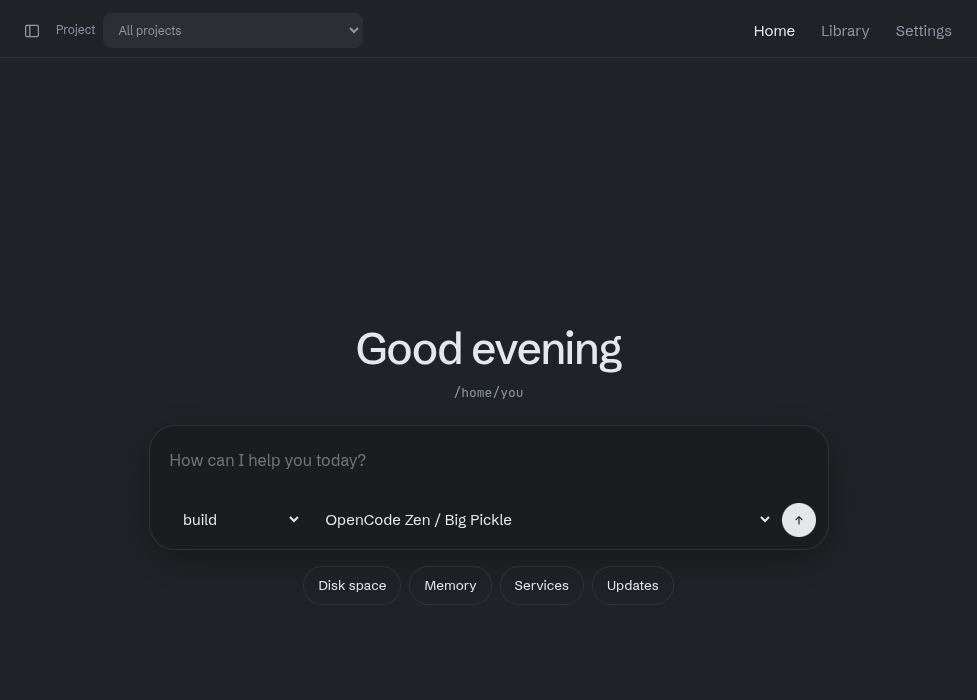

# Openview

Openview is a browser client for [OpenCode](https://opencode.ai). It lists sessions from every project and lets you read them, send messages, rename them, stop a running turn, undo a turn, and delete them. The same page works on a phone over your LAN or Tailscale.

The browser page is `index.html`. Styles live in `css/app.css`, and the client is split across `js/` so each area is its own file. `server.mjs` is a small Node proxy: it serves those files and forwards everything else to `opencode serve`. The database reader is `lib/db.mjs`. The agent and skill writer is `lib/library.mjs`. The self-hosted model writer is `lib/config.mjs`.

## Layout

| Path | Contents |
| --- | --- |
| `index.html` | Page shell |
| `css/app.css` | Layout and theme |
| `js/` | Browser client, one file per area |
| `server.mjs` | Proxy, static files, and the Home route |
| `lib/db.mjs` | Read-only session database |
| `lib/library.mjs` | Writes an agent or skill file |
| `lib/config.mjs` | Self-hosted model entries in `opencode.jsonc` |



The path under the greeting is the home folder of the machine running the proxy.

## Requirements

- [OpenCode](https://opencode.ai), with its HTTP server running
- Node.js 22 or newer, so the proxy can read OpenCode’s session database

The proxy itself runs on Node 18 or newer. Without `node:sqlite`, the sidebar still lists sessions, but only the ones the HTTP API returns.

## Start it

From this directory:

```bash
./start.sh
```

On Windows:

```powershell
powershell -ExecutionPolicy Bypass -File .\start.ps1
```

The script starts `opencode serve` on 127.0.0.1:4096 when that port is free, then runs the proxy in the foreground. Stopping the script also stops the OpenCode process it started. An OpenCode server that was already running is left alone.

To start the two processes yourself, run OpenCode in one terminal:

```bash
opencode serve --port 4096
```

And the proxy from this directory in another:

```bash
node server.mjs
```

Open http://127.0.0.1:8080.

Leave **Settings → Server URL** empty when you use the proxy. A URL there is only for talking to OpenCode directly from the browser, and that also needs `opencode serve --cors` for your origin.

## Use it

### Home

With no session open, the page is Home. The greeting follows the time of day. The box in the middle starts a session in the proxy machine’s home folder, which is the right place for system tasks that are not tied to a git project.

The chips under the box (**Disk space**, **Memory**, **Services**, **Updates**) only fill the box. They do not send. Edit the text if you want, then send it. Openview creates the session, shows your message with a working animation, and stays on that animation until a reply begins.

**Home** in the header returns to this page. **+** next to Home in the sidebar starts an empty session in that folder, with no message yet. Those sessions stay under Home. The project menu leaves the home folder out. Recents can still include them.

Inside Docker, Home is the container user’s home, not the host’s.

### The session list

The icon at the left of the header opens and closes the session list. That choice is remembered, and the conversation does not shift when the list closes.

**All projects** is the default. That view has three parts:

1. **Home**, when the proxy can see a home folder.
2. **Recents**, the eight newest sessions.
3. **Projects**, each project from the one with the most sessions to the one with the fewest.

The chevron beside Home, Recents, or a project hides that list. Click the chevron or the name. The choice is remembered. **+** on Home or a project starts a session there.

The search box filters titles. **New project** in the header, and **New session** in the sidebar, open a folder list. **Different folder** is already selected: click a folder to open it, and **Up** goes to the parent. **Create** starts the session in the path shown. **Existing project** uses a project OpenCode already knows. **+** on Home or a project still starts a session there without asking.

Pick one project in the header to limit the sidebar to that project. Sessions are then grouped by Today, Yesterday, This week, and Older.

A dot on a row shows that the session is working. **permission** means OpenCode is waiting for an answer.

### A conversation

Open a session from the list. The title and the project path sit above the transcript. **Rename** and **Delete** are on that bar.

Type in the box at the bottom and press Enter to send. Shift+Enter adds a line. On a phone, use the send button. While a turn is running, **Stop** aborts it. A message sent during a busy turn is queued, and you can remove it before it goes out.

The **Agent** and **Model** menus start on **build** and **Big Pickle**. They follow the open session, or the home folder when none is open. Switching folder replaces the agent list, so a project-only agent does not stay selected on Home. If your saved agent is missing there, the menu returns to **build**.

Code blocks have a copy button. Open a tool row to read output that was shortened in the page.

When OpenCode asks for permission, the card offers **Allow once**, **Always allow**, and **Reject**. A question from the model can be answered or dismissed.

### Files and undo

When a session has file changes, a panel opens on the right. The header shows the branch and how many files differ. Each row is a status letter, the file name, and the added and removed counts. Select a row to read that file’s diff. The icon at the right of the header slides the panel closed, and that choice is remembered. Closing it leaves the conversation where it is.

A folder that is not a git checkout only shows files touched in the session. The panel stays hidden when there is nothing to report. The list refreshes when the session goes idle. Home is not a git checkout, so that panel stays hidden there.

**Undo** on one of your messages reverts the session to just before that message. Later messages are set aside, and files written after that point go back. **Restore** puts the messages and the files back. Undo waits until the session is idle.

### Agents and skills

**Library** in the header writes one markdown file. OpenCode has no create API for these; it discovers files.

| Kind | This project | Every project |
| --- | --- | --- |
| Agent | `<project>/.opencode/agents/<name>.md` | `~/.config/opencode/agents/<name>.md` |
| Skill | `<project>/.opencode/skills/<name>/SKILL.md` | `~/.config/opencode/skills/<name>/SKILL.md` |

The name is lowercase words with single hyphens. For a skill, that name is also the folder name. A primary agent appears in the agent menu. A subagent is one another agent can call. The file body is the agent prompt, or the skill instructions. The description is what the model sees when deciding whether to load a skill.

**Skill** in the message box runs a skill OpenCode has already loaded. **No skill** sends a normal message. The text you type is the instruction for that skill, and the agent and model menus still apply. A skill saved from Library shows up in that menu after you restart OpenCode and reload this page.

Saving replaces an existing file only after you confirm. Names cannot contain path separators. The proxy will not write into `/` or your home directory, and it will not follow a symlink out of the destination folder.

When the proxy runs in Docker it cannot see your config directory, so a global save returns the markdown to copy onto the host. A project save works only when that project directory exists inside the container.

### Appearance

**Settings → Theme** chooses the look. **System** follows this device. **Light** and **Dark** are Openview’s own colors. The rest are the usual palettes: Catppuccin Latte, Frappé, Macchiato, and Mocha, plus Nord, Dracula, Gruvbox, Tokyo Night, Rosé Pine, Solarized, and One Dark. The choice is remembered in this browser.

### Self-hosted model

**Settings** has a form for a model that runs on your own server. Ollama, LM Studio, and vLLM fill in the usual address. Any other OpenAI-compatible server needs a short provider id, such as `local`.

The model id is the name your server expects. **Use as the default model** writes `model` in `opencode.jsonc`. **Use for short tasks** writes `small_model`, which OpenCode uses for work such as session titles. A model already in the file has the same two checkboxes in the list above the form. **Remove** deletes that model. If it was the default or the short-task model, those lines go with it. Other models stay.

The address, display name, menu name, and an optional API key are stored on that provider. Leave the key empty when the server does not ask for one. **This model can use tools** stays on unless the model has no tool calling. Context tokens and max output tokens are optional, and they are saved together. **Default agent** can be `build` or `plan`.

Saving keeps every other setting in the file, including permissions. A file that contains comments is left untouched. Restart OpenCode, then reload Openview, before the new model appears in the menu. Inside Docker the form explains that the file has to be edited on the host.

## Phone, LAN, and Tailscale

Binding beyond loopback exposes the UI to anyone who can reach the port. Set a password on the UI, and set one on OpenCode too:

```bash
OPENCODE_SERVER_PASSWORD='replace-me' opencode serve --port 4096 --hostname 127.0.0.1

UI_USERNAME=opencode UI_PASSWORD='replace-me-too' \
  HOST=0.0.0.0 PORT=8080 \
  OPENCODE_SERVER_PASSWORD='replace-me' \
  node server.mjs
```

Open `http://<lan-or-tailscale-ip>:8080`. OpenCode can stay on `127.0.0.1`. The proxy is the only process that needs to face the network. If `HOST` is not a loopback address and `UI_PASSWORD` is unset, the process prints a warning.

## Docker

OpenCode keeps running on the host. The image is only this proxy.

```bash
opencode serve --port 4096 --hostname 127.0.0.1
docker compose up --build
```

Compose uses the host network, so `OPENCODE_URL` defaults to `http://127.0.0.1:4096` and the UI defaults to `http://127.0.0.1:8080`. The database directory is mounted read-only at `/data/opencode` (`OPENCODE_DATA_DIR`, default `$HOME/.local/share/opencode`). The process still opens the file with `node:sqlite` `readOnly: true`.

`opencode serve --hostname 127.0.0.1` is not reachable from a bridge network. Host networking is what makes that bind work. To publish the UI on a user-defined network instead, run OpenCode on an address the container can route to and pass that URL:

```bash
docker build -t openview .
docker run --rm -p 127.0.0.1:8080:8080 \
  --add-host=host.docker.internal:host-gateway \
  -e OPENCODE_URL=http://host.docker.internal:4096 \
  -e OPENCODE_DB=/data/opencode/opencode.db \
  -v "$HOME/.local/share/opencode:/data/opencode:ro" \
  openview
```

Inside the image the process binds `0.0.0.0` so Docker’s published port can connect. That prints the non-loopback warning even when `-p` is limited to `127.0.0.1`.

For a phone, LAN, or Tailscale, set a UI password and bind the host address. With Compose that is `HOST=0.0.0.0` (host networking has no separate publish address):

```bash
UI_USERNAME=opencode UI_PASSWORD='replace-me' HOST=0.0.0.0 docker compose up --build
```

Set `OPENCODE_SERVER_PASSWORD` to the same value passed to `opencode serve` when that server requires Basic auth.

## Configuration

| Variable | Default | Purpose |
| --- | --- | --- |
| `OPENCODE_URL` | `http://127.0.0.1:4096` | OpenCode server to proxy |
| `HOST` | `127.0.0.1` | Address this UI binds |
| `PORT` | `8080` | Port this UI binds |
| `OPENCODE_SERVER_USERNAME` | `opencode` | Basic auth username sent upstream |
| `OPENCODE_SERVER_PASSWORD` | unset | Basic auth password sent upstream |
| `UI_USERNAME` | empty | Optional username for the UI itself |
| `UI_PASSWORD` | unset | Optional password for the UI itself |
| `OPENCODE_DB` | unset | Optional path to `opencode.db` |

## Where the session list comes from

`GET /session` only returns the project selected by `?directory=` (or the server’s working directory). The sidebar does two things:

1. It loads `GET /project`, then `GET /session?directory=<worktree>` for each project, and sorts by `time.updated`. The worktree `/` is skipped. Each later call for a session sends `?directory=` from that session.
2. It also asks the proxy for `GET /_db/sessions`. That endpoint opens OpenCode’s SQLite file read-only (`node:sqlite`, `readOnly: true`, `PRAGMA query_only`). It never writes. Deletes, renames, and prompts still go through the OpenCode HTTP API. If the file is missing the proxy returns 404. If `node:sqlite` is missing it returns 501. The page ignores both and keeps the API list.

The database path is `OPENCODE_DB`, then `$XDG_DATA_HOME/opencode/opencode.db`, then `~/.local/share/opencode/opencode.db`, then on macOS `~/Library/Application Support/opencode/opencode.db`. If `opencode.db` is not in that directory, the newest `opencode*.db` is used (`opencode-local.db` for dev builds, `opencode.db` for release builds). Columns come from `PRAGMA table_info`, not a hard-coded schema. Root sessions only; archived rows are omitted unless `?archived=1`. `?q=` searches titles and `?limit=` caps the list.

API rows win over database rows when both exist. A database session whose project the server cannot open shows: “This session’s project isn’t available to the server.”

Live updates prefer `GET /global/event`, one server-sent stream for every project (`{directory, payload}`). If that route is missing, the page opens `GET /event?directory=` per project. Streams use `fetch` and a `ReadableStream`, so auth headers work. A dropped stream reconnects after 2 seconds and reloads sessions and the open transcript.

`GET /_home` on the proxy returns the home directory used by the Home page. It refuses the filesystem root.

## Limits

- Child sessions and archived sessions are hidden.
- The markdown renderer covers headings, lists, blockquotes, tables, links, emphasis, inline code, and fenced code. It does not render raw HTML, images, or nested lists.
- Tool output is shortened in the page until you open the tool row.
- There is no file upload or fork.
- A direct server URL in Settings needs OpenCode’s `--cors` flag. The proxy path does not.
- The database reader can miss a session that has not been committed yet, and it cannot revive a project the running server has never opened. Those rows still appear, and opening them explains that the project is unavailable.
- A project with no agents and no models configured still lets you send with the server’s defaults.
- Status, permissions, and agents are best-effort. A missing optional route does not blank the page.
